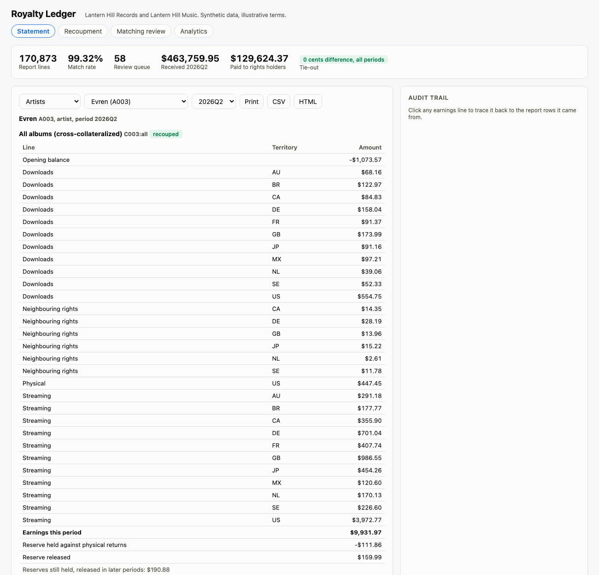
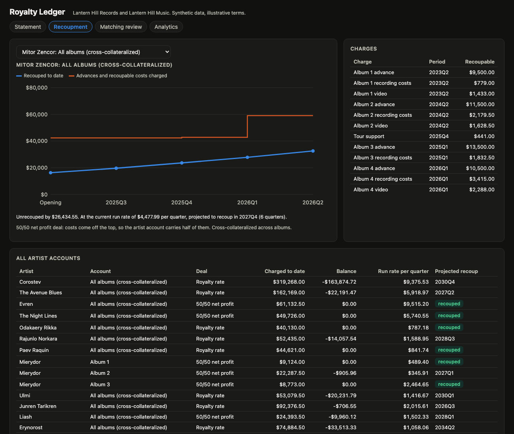
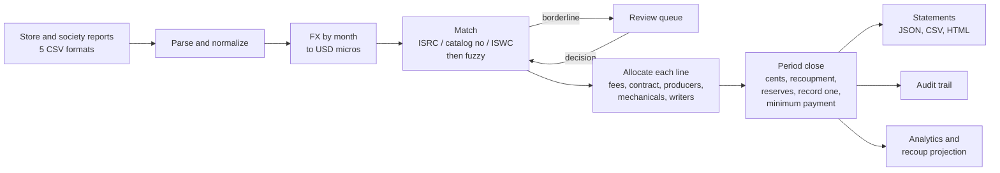

# royalty-ledger

Royalty accounting for Lantern Hill Records and Lantern Hill Music, a made-up independent label and its publishing arm. It ingests monthly usage reports from four fictional stores and a quarterly report from a fictional rights society, each in its own CSV dialect and currency. It matches every line to a recording, release or composition, splits the money across artists, producers, songwriters and co-publishers under each contract, recoups advances and costs, holds and releases reserves, and produces quarterly statements with an audit trail from any statement line back to the report rows it came from. Every period ties out to the cent.



| Result | Number |
|---|---|
| Catalog | 60 artists, 412 releases, 2,654 tracks and compositions, 172 songwriters, 40 producers, 60 contracts (40 royalty rate, 20 net profit; 48 cross-collateralized) |
| Reports | 52 files in 5 formats, 170,873 lines, 12 months (Jul 2025 to Jun 2026), 9 currencies, 11 territories |
| Matching | 99.32% of lines matched automatically, 169,703 of 169,703 matches correct against ground truth. 1,108 lines (58 metadata keys) in the review queue, top candidate correct for all of them. 62 lines left unmatched, all 62 truly not in the catalog |
| Tie-out | 4 quarters, $1,583,113.10 received, 0 cents difference between money received and money allocated in every quarter |
| 2026Q2 statements | 218 payees, 102 paid a total of $59,973.58, the rest unrecouped or below the minimum payment |
| Tests | 114 passing in about 20 seconds |

## Why

Royalty accounting is where trust between a label and its artists is won or lost. Store reports arrive in different formats, currencies and levels of care: ISRCs with hyphens, ISRCs missing, a track title with "(Remastered)" stuck on, an artist name spelled three ways, the wrong ISRC typed against the right title. Money that cannot be matched must not be guessed into someone's statement. Once matched, one stream is split under a stack of rules: a distribution fee, a royalty rate that drops outside the home territory, producer points that come out of the artist's share and may only be payable after recording costs are recouped, mechanicals the label owes the songwriters, and publishing income split across writers and publishers under different deals. Then advances and costs are recouped, sometimes across albums and sometimes not, reserves are held against physical returns and released later, and small balances carry forward until they reach the minimum payment. An artist should be able to ask "where did this $986.55 come from" and get the 95 report rows behind it.

| Problem | How it is handled | Where |
|---|---|---|
| Five report formats | One parser per format, detected from the header, normalized to one line shape. Bad headers and short rows are rejected with the file and line number. | `reports.py` |
| Currencies | FX rate per currency per usage month, as data. Exact `Decimal` from the report times the rate, rounded half-even to the micro-dollar. | `rules.py`, `data/rules.json` |
| Sub-cent amounts | Lines are in USD micros (one millionth of a dollar). Statements are in cents. See the rounding rules below. | `money.py` |
| Messy identifiers | ISRC, catalog number or ISWC first, with a title check. Then fuzzy title and artist matching inside the artist's catalog. Confident matches are accepted, borderline ones go to review, the rest stay in suspense. | `matching.py` |
| A wrong ISRC on the right title | If the title disagrees with the ISRC's track, or another track by the same artist fits the title better, the line goes to review instead of paying the wrong artist. | `matching.py` |
| Contract math | Royalty rate deals and 50/50 net profit deals, per-format rates, a foreign rate factor, producer points from the artist's share. | `engine.py` |
| Publishing | Writer shares in basis points that must sum to exactly 10,000. Label-paid mechanicals go to every share; society income goes to the shares Lantern Hill Music controls, then to the writer under a traditional, co-publishing or administration deal. | `engine.py`, `catalog.py` |
| Recoupment | Advances, recording, video (50% recoupable) and tour support charged to an account. One account per contract when cross-collateralized, one per album when not. Negative accounts never offset positive ones. | `engine.py` |
| Reserves | A share of positive physical earnings is held and released in equal parts over the next two quarters. Returns arrive as negative lines. | `engine.py` |
| Proof | Every line's parts must add back to the line (checked on every line). Every period's buckets must add up to the money received. A CI gate recomputes 2026Q2 and fails if any payee's statement changes. | `engine.py`, `cli.py` |

## Worked statement

Evren (A003) has a 50/50 net profit deal, cross-collateralized across albums, with a 25% reserve on physical sales. They started the ledger $25,021.12 unrecouped and recouped during 2026Q2. Output of `royaltyledger statement A003 --period 2026Q2`, with the per-territory lines folded into one line per source (the full statement has 29 earnings lines, one per source and territory):

```
Evren (A003), artist, period 2026Q2

  All albums (cross-collateralized) [C003:all]
    Opening balance                                           -$1,073.57
    Streaming, 11 territories                                  $7,864.54
    Downloads, 11 territories                                  $1,533.87
    Physical, US                                                 $447.45
    Neighbouring rights, 6 territories                            $86.11
    Reserve held against returns (25% of physical)              -$111.86
    Reserve released (from 2025Q4 and 2026Q1)                $159.99
    Closing balance                                            $8,906.53

  Payable $8,906.53 (minimum payment $100.00)
  Reserves still held, released in 2026Q3 and 2026Q4: $190.88
```

The "Streaming, GB" line on that statement is $986.55. `GET /api/audit?line=2026Q2|A003|C003:all|Streaming|GB` returns the 95 report rows behind it, for example line 960 of `tidepool_202604.csv`: 1,922 streams of "Violet" in GB, reported as EUR 9,0375 with a decimal comma, converted at the April rate to $9.593306, of which $3.967791 is Evren's share after the 12% distribution fee and the 50/50 split. The 95 shares add up to $986.554632, which rounds to the $986.55 on the statement.

## Recoupment



Of 83 artist accounts (60 artists; 12 artists without cross-collateralization have one account per album), 15 are recouped at the end of 2026Q2 and 68 are not. That is normal for a label: most advances never fully recoup. The projection divides the unrecouped balance by the average of the last two quarters of earnings (after reserves):

| Projection at the 2026Q2 run rate | Accounts |
|---|---|
| Recouped | 15 |
| Within 4 quarters | 8 |
| 5 to 12 quarters | 5 |
| More than 12 quarters | 55 |

Total unrecouped across all accounts: $945,390.28, against $2,597,593.00 of recoupable charges to date.

Mitor Zencor (C029, net profit, cross-collateralized) shows why cross-collateralization matters. Their album 4 advance and costs landed in 2026Q1 and added $16,203 to the balance, so earnings from the first three albums now recoup album 4 too. At $4,477.99 per quarter they are projected to recoup in 2027Q4.

Producers on "record one" terms are paid only after the artist's account has recouped its recording costs, then retroactively from the first sale. In this run, 6 producer accounts crossed that line and were paid $28.31 of held royalties on top of the current quarter.

## Rounding rules

1. FX: report amount (exact decimal) x rate for the usage month, rounded half-even to the micro.
2. A share of a line (fee, royalty rate, producer points, writer deal share) is rounded half-even to the micro. The label (master income) or the publisher (publishing income) takes the remainder, so the parts of a line add back to the line exactly.
3. Splits between several parties (writer shares, a release's tracks, reserve installments) use the largest remainder method.
4. At period close, every bucket (payee, account, source, territory, plus fees, tax, label share, publisher share and suspense) is converted to cents with the largest remainder method, so the cents add up to the quarter's receipts rounded half-even to the cent.

## Architecture



Contract terms, store fees, territory rules (home or foreign rate, mechanical rule, withholding tax), FX rates, writer deal shares, recoupable percentages and minimum payments are data (`src/royaltyledger/data/rules.json` and the generated `catalog.json`), not code.

## How to run

```bash
cd royalty-ledger
uv sync --python 3.12
uv run royaltyledger generate          # seeded catalog and 12 months of reports into data/ (about 3 seconds)
uv run royaltyledger serve --port 8882 # then open http://127.0.0.1:8882
uv run royaltyledger statement A003 --period 2026Q2
uv run royaltyledger eval              # tie-out per quarter and matching scores
make gate                              # what CI runs
```

`serve` generates the data on first start if `data/` is empty. Loading 170,873 lines takes about 7 seconds (parse 1.4 s, match 1.1 s, compute 3.2 s). A review decision recomputes all four quarters, which takes a few seconds.

API: `GET /api/statements/{payee}?period=2026Q2&format=json|csv|html`, `GET /api/audit?line=...`, `GET /api/recoupment`, `GET /api/review`, `POST /api/review/{key_id}` with `{"action": "accept", "target": "T00321"}` or `{"action": "reject"}`, `POST /api/ingest?name=file.csv` with the CSV as the body, `GET /api/analytics`, `GET /api/tieout`, `GET /healthz`, `GET /metrics`. Logs are one JSON object per line.

Web UI at `/`: printable artist statement with the audit trail beside it, recoupment tracker, matching review queue, and analytics (top tracks, territories, per-stream rates by store and territory, recoup projections). Light and dark mode, no horizontal scroll at phone width.

## Tests

114 tests, about 20 seconds: `uv run --python 3.12 --group dev pytest -q`.

- Money and FX: half-even rounding with negatives, largest remainder splits, bucket-to-cents tie-out, rates by month, missing rates are errors.
- Report parsing for each of the 5 formats, format detection, decimal commas, dates, returns, bad headers and short rows.
- Matching: exact ISRC with store formatting, fuzzy title and artist, review band, ISRC with a conflicting title, catalog number and ISWC paths, review decisions, and match rate and precision against ground truth on generated data.
- Each contract type, the foreign rate factor, producer points with and without record-one recoupment, mechanicals per unit and per cent, writer deals, withholding tax, physical lines expanded to tracks, suspense, and 500 random lines that must allocate exactly.
- Publishing splits summing to 100% for every generated composition.
- Recoupment, net profit cost sharing, 50% recoupable video, cross-collateralized vs separate album accounts, reserves held and liquidated (also past the last period), statement balances rolling forward, the minimum payment threshold.
- Audit trail completeness (every earnings line traces to source rows that sum to it and exist in the files), CSV and HTML exports, determinism.
- The CI gate fails when a contract term changes a statement.
- API end to end: health, metrics, statements in three formats, audit, recoupment, analytics, review decisions that move money out of suspense, ingesting a new report, rejecting bad ones.

## CI and DevOps

- `.github/workflows/ci.yml`: ruff (lint and format check), pytest, a statement gate job, and a Docker build with a smoke test.
- The gate regenerates the seeded data from scratch, recomputes all four quarters, and fails if any of the 218 payee statements for 2026Q2 differs from `gate/expected_2026Q2.json` (closing balance, payable and a digest of every line), if any quarter is off by a cent, or if any composition's splits do not sum to 100%. After an intended change, `make gate-update` rewrites the file and the diff shows exactly which statements moved.
- `Dockerfile`: multi-stage, slim base, non-root user, data under `/app/data` owned by that user, HEALTHCHECK on `/healthz`.
- `Makefile`: `install`, `test`, `lint`, `format`, `generate`, `run`, `gate`, `gate-update`, `statement`, `screenshot`, `docker-build`, `docker-run`.
- Docker is not installed on the machine this was built on. The image and the workflow are built and run in CI only.

## Honest notes

- The seed (7) is the first one tried. Matching thresholds (auto-accept at 0.93, review from 0.75) were set before looking at results and not tuned afterwards.
- The data generator is synthetic and its defects are simpler than real ones. Every misspelling it makes is one the matcher was designed to catch, so the match rate and precision overstate what a real catalog would see.
- The generator drops store lines under 1,500 streams per track, territory and month to keep the data set small, so the long tail is thinner than real reports.
- Earnings before July 2025 are a single migrated number per account.

## Production notes

- Store each report file and its parsed lines in a database with the file hash, so re-sent reports are detected and every statement can be re-run exactly as it was issued.
- Recompute incrementally: only lines whose match changed, and only periods from the earliest affected one. Here a review decision recomputes everything.
- Treat a closed period as immutable. Late corrections go into the next period as adjustments, with the original statement kept.
- Contract terms would come from a contract system with effective dates per clause (rate escalations, controlled composition caps, audit rights) rather than one JSON document.
- Real matching adds UPC, ISWC lookups from society data and a shared alias table built from past review decisions.
- Payments, tax forms and withholding certificates would sit behind the payable amount, with approvals.

The contract terms, rates, fees, deal structures and FX rates here are illustrative and made up. This is not legal or accounting advice. All artists, songs, companies and identifiers are fictional; ISRCs use the user-assigned country code ZZ.

## License

MIT. See [LICENSE](LICENSE).
